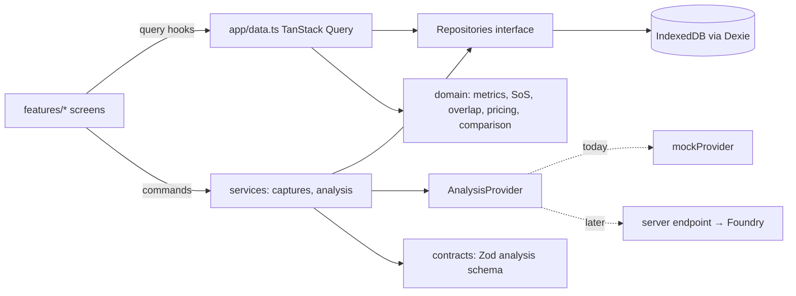

# Architecture

## Overview

## Layers and boundaries

| Folder           | Owns                                                                                                                                                     | May depend on                                     |
| ---------------- | -------------------------------------------------------------------------------------------------------------------------------------------------------- | ------------------------------------------------- |
| `src/domain`     | Models, catalogue types, SoS, overlap reconciliation, corrections, pricing, comparison, aggregation. Framework-free, reusable in React Native.           | `contracts` (types only)                          |
| `src/contracts`  | Zod schemas for analysis request/response; schema version.                                                                                               | `domain/categories`                               |
| `src/services`   | Repository interfaces and Dexie implementation, seed data, capture/draft service, analysis job service, providers, demo data, visit summaries. No React. | `domain`, `contracts`                             |
| `src/app`        | Composition: config, services context, query hooks, router, root layout.                                                                                 | everything                                        |
| `src/features/*` | Screens by area: `session`, `home`, `stores`, `capture`, `visit`, `results`, `archive`, `shared`. Presentation + calling services.                       | `app`, `services` (types), `domain`, `ui`, `i18n` |
| `src/ui`         | Tokens, global CSS, icons, primitives (Button, Screen/TopBar, BottomNav, Sheet, Segmented, Badge/Notice, BlobImage, Toast).                              | `i18n`                                            |
| `src/i18n`       | All user-facing strings and locale formatters.                                                                                                           | `domain` types                                    |

Business rules live in `domain`; orchestration in `services`; components only render and call
services, then invalidate queries.

## Data ownership and persistence

All data is on the device in IndexedDB (`ShelfwiseDb`, Dexie):

| Table            | Contents                                                                                                                                                    |
| ---------------- | ----------------------------------------------------------------------------------------------------------------------------------------------------------- |
| `reps`, `stores` | Seeded (`services/seed`, versioned by `SEED_VERSION`). Stores keep `mustStockProductIds`/`targetPrices` for deferred KPIs.                                  |
| `visits`         | One record per visit: store, rep, status (`draft`/`submitted`/`completed`), idempotency key, job/result ids, timestamps. Never overwritten by later visits. |
| `captures`       | Photo metadata: sequence, captured time, source (`camera`/`import`/`demo`), dimensions, blob ids.                                                           |
| `blobs`          | Original JPEG/imported files (full resolution) and ~480 px thumbnails.                                                                                      |
| `jobs`           | Analysis jobs: status, attempts, real preparation progress, failure.                                                                                        |
| `results`        | Validated `AnalysisResponse` per job (`result-<jobId>`), plus storage time.                                                                                 |
| `corrections`    | Rep corrections keyed by result and target (facing key or label id).                                                                                        |
| `meta`           | Current rep id, seed version.                                                                                                                               |

The catalogue (`services/seed/catalogue.ts`, version `dk-seed-2026.11`) is code, exposed via
`repos.catalogue`. Metrics are **not stored**; they are recomputed from the stored response +
corrections, so the calculation method stays explicit (`SOS_METHOD_VERSION`) and results stay
export-friendly (flat, versioned observations).

Storage limits: browsers may evict IndexedDB under pressure; the app requests persistent
storage (`navigator.storage.persist()`) but this is not guaranteed. Photos are stored at full
camera resolution (~1–4 MB each). This is not an offline-sync system: data does not leave the
device until a live backend exists.

## Analysis flow

1. `analysis.submitVisit(visitId)` → `repos.visits.attachJob` runs in a single IndexedDB
   transaction: returns the existing job or creates one and marks the visit `submitted`.
   Repeated taps cannot create a second job.
2. The job runner (module-level, survives navigation) reads each photo blob
   (`preparing`, real `done/total`), builds and validates an `AnalysisRequest`, calls the
   provider (`analysing`), validates the response, and completes in one transaction
   (`visits.completeJob`): result stored under a deterministic id, visit and job completed —
   only if the visit still owns the job and the job wasn't cancelled. Retries reuse the job
   and overwrite the same result id. Job writes never override a `cancelled` status.
3. Failures are stored on the job with `retryable`. _Edit photos_ (`visits.reopen`) cancels the
   job and reopens the draft with a new idempotency key in one transaction.
4. Submission first waits for in-flight capture writes (`captures.whenIdle`), so a photo saved
   just before tapping _Analyze_ is never dropped or left out.
5. On app start, `resumeInterrupted()` restarts jobs left `queued/preparing/analysing`.
6. UI polls IndexedDB while a submitted visit awaits its result (TanStack Query
   `refetchInterval`).

## Integrations (planned)

- **Live analysis:** a small backend (hosting TBD) receives request + images, calls Microsoft AI
  Foundry with server-held credentials, maps the provider output to `AnalysisResponse`, and
  returns it. The browser adds an `AnalysisProvider` that posts to this backend. The UI and
  domain do not change.
- **Persistence API:** replace `createDexieRepositories` with an HTTP implementation of the
  same `Repositories` interface; keep IndexedDB for drafts/blobs until upload.
