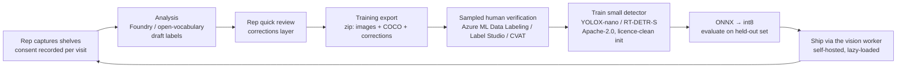

# Model training (groundwork)

Shelfwise's live camera guidance uses a generic COCO detector, and analysis is still mocked.
Commercially usable shelf-facing weights don't exist off the shelf (see
[decisions.md → Shelf "slot" detection — licence review](decisions.md#shelf-slot-detection--licence-review-11-nov-2026)).
The long-term path is to **train our own detector on our own photos**. This document covers
what the app already provides for that, and what still has to happen outside it.

**In the app today (no backend, no uploads, no training):** consent and retention fields, full
capture metadata, and a developer-only training export (zip). Nothing leaves the device unless
a developer exports it.

## Data flywheel

1. **Capture.** Only visits whose rep had _training consent_ on at submission qualify. Each
   photo carries resolution, capture and save times, source (camera/import), coarse device
   family, camera settings (facing, zoom, torch, stream size) and overlap placement. It never
   carries location.
2. **Draft labels.** Analysis observations become COCO boxes. Today they come from the mock
   provider (`source: "mock"`), which is illustrative only and **must never be used to train or
   evaluate**. Real drafts will come from the live provider: the Copilot Studio agent for
   the POC (`provider.name: "copilot-studio"`; its boxes are rough), and later Foundry or an
   open-vocabulary model such as OWLv2/Grounding DINO server-side.
3. **Rep corrections** are exported as a separate layer linked to the annotations. They are
   evidence for verifiers, not ground truth.
4. **Verification.** Import the package into a labelling tool and have trained labellers verify
   a sample (all of it at first, then 10–20 % spot checks plus every `needsReview` item and
   every rep correction).
5. **Train.** Use a class-agnostic detector from Apache-2.0 code with licence-clean
   initialisation: ImageNet/COCO-pretrained, **not** Objects365 or SKU-110K. Track the
   dataset version, code commit and hyper-parameters per run.
6. **Ship.** Export to ONNX, quantise (int8), and check on-device speed on the slow-device
   budget (auto-off above ~300 ms). Load it through the existing vision worker; anything over
   ~15 MB follows the data-cost rule (UX guidelines).

## Labelling guidelines (v1)

Start class-agnostic, because one well-labelled class beats many noisy ones:

- **facing**: one box per front-facing product unit visible on the front row (can, bottle,
  carton, multipack front). Box the visible product, not the price label or the shelf edge.
  Include partly occluded facings if more than ~50 % of the front is visible. Skip products
  deeper in the shelf that are only visible from above.
- **price_label**: the whole shelf-edge label or price sticker, including the multibuy text.
- **promotion**: promotional signage (shelf wobblers, posters, "2 for" strips).
- **display**: floor or end-cap display units (counted separately; never in Share of Shelf).
- Brand and product go in **attributes** (`brandId`, `productId`, `brandRelation`), never in the
  class. Later, brand groups (client owned/licensed vs competitor, then top brands) become
  classes without redrawing boxes.
- Mark images with people visible (`containsPeople: "yes"`). Blur faces before labelling, or
  exclude the image.
- Exclude unusable photos (blur, glare, not a shelf), but keep them as hard negatives for the
  image-quality checks.

## Data needs (rough)

| Stage              | Photos                                    | Notes                                                        |
| ------------------ | ----------------------------------------- | ------------------------------------------------------------ |
| First usable model | 200–500 shelf/cooler photos               | ~20–60 k facing boxes; cover chains, coolers and lighting    |
| Field quality      | 1,500–3,000                               | Every chain, cooler glass and reflections, seasonal displays |
| Brand groups       | +50–100 examples per brand/pack per group | Only after the class-agnostic model is stable                |

Bias to watch: a few stores dominating, only daylight, only one phone model (`device` helps
check this), only tidy shelves.

## Evaluation

Use the **same held-out set as the brief's evaluation** (real store photos with manual ground
truth). Split by store, not by photo, so overlapping photos of one shelf never land in both
train and test. Report:

- detection mAP@0.5 and recall for facings, overall and for cans vs bottles (cans are the known
  weakness);
- count error per shelf (counted facings vs ground truth), because Share of Shelf depends on
  counts;
- on-device latency (desktop, iPhone 15, a mid-range Android).

## Versioning

- **Package:** `manifest.json` → `format: "shelfwise-training"`, `packageVersion` (semver;
  bump the major for breaking file changes), app version + commit, analysis schema, catalogue
  and method versions, SHA-256 per file.
- **Dataset:** a dataset version is a list of package files plus a verification round; keep it
  immutable (e.g. Azure ML data asset versions).
- **Model:** record the dataset version, training code commit, init weights and their licence,
  and the evaluation report next to each exported ONNX file.

## Export package

Developer-only. Enable it with `?dev=1` (or `VITE_DEV_TOOLS=true`), then use _User drawer →
Developer tools · Training export_. You can export one visit, or all analysed visits that
have consent and are within retention. The format is specified in
[analysis-contract.md → Training export package](analysis-contract.md#training-export-package).
Privacy safeguards:

- image metadata is removed (camera photos never have any; imports with EXIF/XMP are
  re-encoded, falling back to stripping the segments);
- no rep identity and no location;
- `containsPeople` defaults to `unknown`.

Peak memory is about the package size plus one photo. Chromium can page large Blobs to disk,
but Safari keeps them in memory, so on a phone export one visit at a time. Measured with 100 ×
3 MB photos: a 300 MB zip in 1.6 s (Node, desktop).

## Licences

Record each source with its licence before use:

| Item                                    | Licence                   | Status                                   |
| --------------------------------------- | ------------------------- | ---------------------------------------- |
| Our photos and labels                   | Client data agreement     | Needs the agreement below                |
| YOLOX / RT-DETR code                    | Apache-2.0                | OK                                       |
| ImageNet/COCO-pretrained init weights   | Check per checkpoint      | Prefer Apache-2.0 releases               |
| Open Images "Bottle"/"Tin can" (boost)  | CC BY 4.0 (annotations)   | OK with attribution; image licences vary |
| SKU-110K, Objects365-pretrained weights | Non-commercial / academic | **Not usable** (decisions.md)            |
| Ultralytics YOLO, YOLO-World            | AGPL-3.0 / GPL-3.0        | Not usable unless licensed               |

## Privacy and GDPR prerequisites (before any real collection)

- **Data agreement with Royal Unibrew**: purpose (model training for this product), roles
  (controller/processor), retention, sub-processors (Azure region EU), deletion on request.
- **Store permission**: retailers' policies on photographing in store, and whether photos may
  be used beyond the visit report.
- **Rep consent and information**: the in-app toggle (default off) is a technical switch, not a
  legal basis on its own. HR/legal must confirm the basis and the wording. Withdrawal stops new
  visits from qualifying. Removing already-exported data must be handled server-side.
- **People and faces**: shoppers or staff can appear. Set `containsPeople`, blur or exclude
  before labelling, and never train on faces.
- **Retention**: each visit carries `retainUntil` (default 365 days). The app only does a
  conservative local cleanup (originals of analysed visits are replaced by thumbnails after
  the date). **Real retention, deletion and audit are enforced by the future backend**, which
  receives `dataUse` with every analysis request.
- **Security**: exports are files on a developer machine. Keep them in an access-controlled
  store, never in the public repository, and delete local copies after upload.
